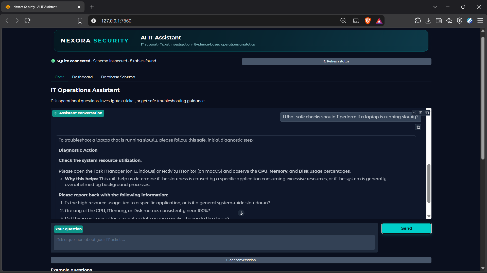
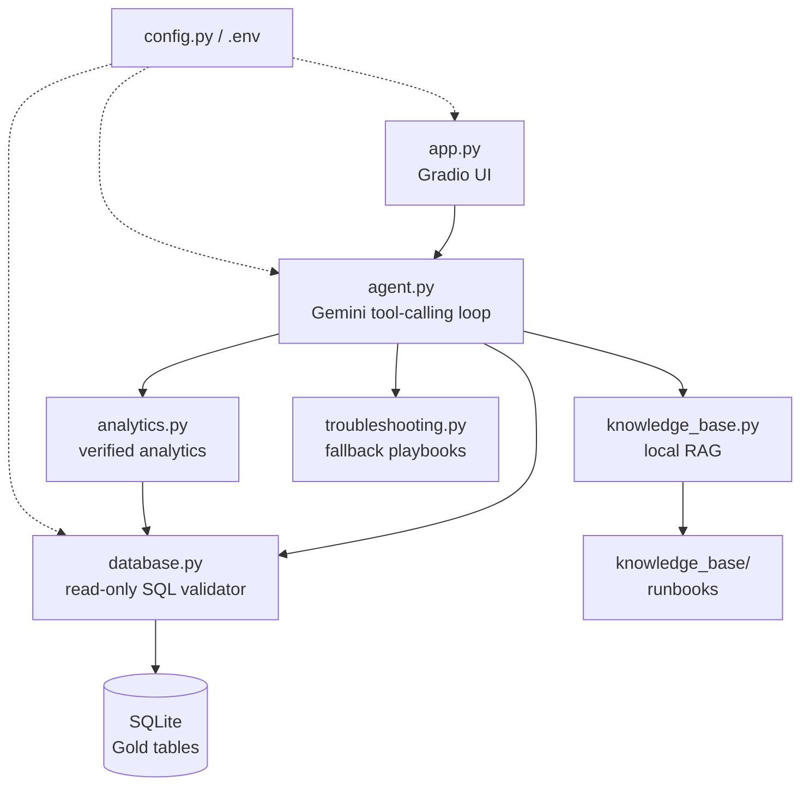
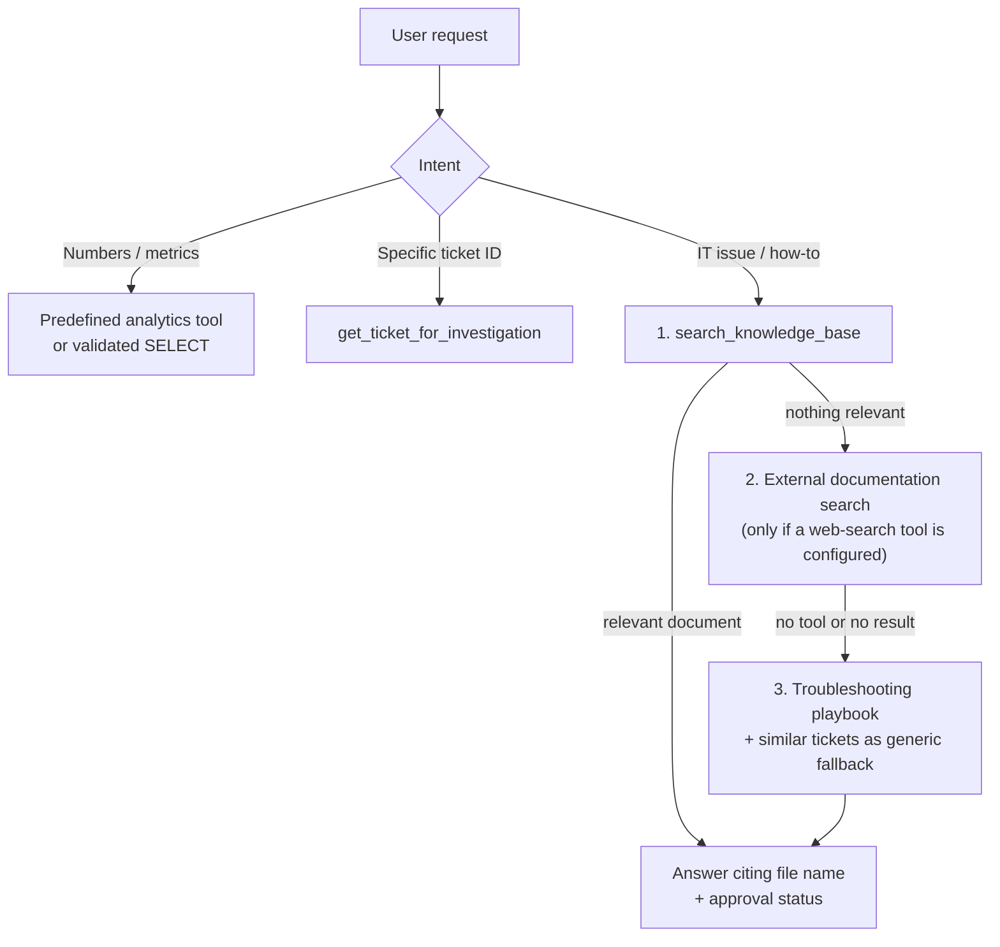

# 🛠️ AI IT Operations Assistant

An AI-powered workspace for IT support teams — explore ticket analytics, investigate individual tickets, and get grounded, safe troubleshooting guidance.


---

## 📖 Overview

AI IT Operations Assistant turns a support-ticket database into an interactive operations center. IT engineers can ask questions in plain language (English or Arabic), browse active tickets, get an AI-generated investigation for any ticket, and draft customer replies — all while the AI stays **read-only**, grounded in real tool results, and privacy-aware.

The assistant never invents numbers. Every figure comes from a predefined analytics function or a validated read-only SQL query, and troubleshooting advice is retrieved from a local knowledge base before falling back to generic playbooks.


---
### 💬 Chat Assistant

<p align="center">
  
</p>


## ✨ Key Features

| | Feature | What it does |
|---|---|---|
| 💬 | **Chat assistant** | Ask about ticket status, trends, SLA, resolution times, or request troubleshooting help. Returns an answer plus a relevant chart and result table. Remembers the recent conversation (see [Conversation Memory](#-conversation-memory)). |
| 📊 | **Operations dashboard** | KPI cards (total tickets, SLA breaches, customer satisfaction) and charts by status, priority, issue category, creation trend, and resolving staff. |
| 🎫 | **Ticket workspace** | Searchable / filterable active-ticket table. Selecting a row instantly shows the record and classification, then streams in an AI investigation (Summary + Detailed Analysis). |
| ✍️ | **AI reply copilot** | Generates an editable, professional customer reply draft with one-click copy. Nothing is ever sent automatically. |
| 📚 | **Knowledge-base RAG** | Multilingual semantic search over local IT runbooks (`.md`, `.txt`, `.pdf`, `.docx`) with approval-status labels. |
| 🧪 | **Troubleshooting playbooks** | Safe, general triage steps for common IT domains, used as a last-resort fallback. |
| 🔎 | **Similar-ticket search** | Keyword search over historical ticket descriptions and resolution notes for extra context. |
| 🗂️ | **Schema inspector** | Live view of the database tables and columns without modifying anything. |

---

## 🏗️ Architecture



The LLM never touches the database directly: it requests a tool, and **Python** validates and executes it.

---

## 🧭 Intent Routing & Troubleshooting Workflow

The agent routes each request by intent. For technical issues it follows a strict source-search order so advice is evidence-based.



Troubleshooting is **interactive**: the assistant gives **one** safe diagnostic action (or asks one essential question) per reply and waits for your result before suggesting the next step.

> A web-search tool is not included by default, so step 2 is skipped unless you add one (see [Possible Next Steps](#-possible-next-steps)).

---

## 🧠 Conversation Memory

The chat has **short-term memory only**:

- The last **8 messages** (about 4 question/answer pairs) are sent to the model with each new question.
- Each remembered message is trimmed to **1,800 characters**.
- Only the **text** of questions and answers is remembered. Raw tool outputs, charts, and tables are not stored, so a follow-up that depends on a number works only if that number appeared in the previous answer (otherwise the assistant re-queries the tool).
- **Clear conversation** wipes the memory, and nothing is persisted after the page is closed.
- The dashboard's *AI Ticket Insights* and *Reply Draft* run **without** chat history.

Each request logs a line like `Chat memory: 3 of 4 history messages sent to the model`, which makes memory problems easy to diagnose.

## 🌐 Language Behavior

- Chat answers follow the language of your **latest message**: ask in Arabic (including Egyptian Arabic) and get Arabic, switch to English and get English. Commands, product names, and exact error messages stay in English.
- The dashboard's AI ticket analysis and customer reply drafts are generated in **English**.

---

## 🛡️ Safety & Privacy by Design

- **Read-only by construction** — only one validated `SELECT` is ever executed; the assistant cannot create, update, assign, close, or delete anything.
- **Approved schema only** — queries are limited to eight Gold tables: `facttickets`, `dimcustomer`, `dimdate`, `dimissue`, `dimstaff`, `dimticketcontext`, `dimticketflags`, `dimticketstate`.
- **PII protection** — columns such as customer email, name, age, and gender are blocked; no wildcard projections; secrets and emails are redacted from retrieved knowledge-base text and ticket free text.
- **Prompt-injection resistant** — retrieved documents, ticket text, and notes are treated as untrusted evidence, never as instructions.
- **No fabricated sources** — the model may only cite tools that actually returned results.
- **Honest metrics** — resolver attribution is never presented as assigned workload; resolution time, wall-clock time, and paused time stay distinct; SLA breach percentages are withheld when flag values are unrecognized; "top categories" answers use totals computed by SQL rather than numbers the model adds up itself.
- **Secrets stay local** — API keys live in `.env` and are redacted from logs and error messages.

---

## 📁 Project Structure

```text
ai-it-operations-assistant/
├── app.py                  # Gradio UI: Chat, Dashboard, Ticket Workspace, Schema tabs
├── agent.py                # Gemini tool-calling orchestration + system prompt + tool schemas
├── analytics.py            # KPIs, SLA/escalation/resolution metrics, charts, ticket investigation
├── database.py             # SQLAlchemy engine, schema inspection, SQL validator (SQLGlot)
├── knowledge_base.py       # Local multilingual RAG: chunking, embeddings, semantic search
├── troubleshooting.py      # Safe general IT playbooks per issue domain
├── config.py               # Settings loaded from environment / .env
├── assets/                 # Branding: nexora_logo.png, favicon.png (optional)
├── knowledge_base/         # IT runbooks (Markdown with front-matter)
│   ├── vpn_troubleshooting.md
│   ├── network_connectivity.md
│   ├── account_access.md
│   ├── email_access.md
│   └── security_incident.md
├── data/                   # Place your local SQLite database here (git-ignored)
├── requirements.txt
├── .env.example
└── .gitignore
```

---

## 🧩 What Each Module Does

| Module | Responsibility |
|---|---|
| `app.py` | Builds the Gradio interface with three tabs — **Chat**, **Dashboard** (KPIs, filters, ticket workspace, analytics accordion) and **Database Schema**. Streams ticket details first, then the AI analysis, so the UI never freezes. Includes the reply-draft generator and clipboard copy. |
| `agent.py` | Defines the system prompt, the 12 tool schemas, and the tool-calling loop (max 4 rounds, one retry on transient errors). Builds the short-term chat memory, executes tools in Python, compacts results, picks the right chart, and converts API errors into friendly messages. |
| `analytics.py` | Predefined, verified queries: ticket summary, by status / priority / issue (with exact per-category totals), trends (day → year), SLA flags, escalations, resolution & satisfaction metrics, resolver workload, active-ticket list, similar-ticket search, and single-ticket investigation. Also builds Plotly charts. |
| `database.py` | Connection handling with timeouts, live schema reflection, relationship verification, and the read-only SQL validator (SQLGlot AST checks, table/column allow-listing, forced `LIMIT`). |
| `knowledge_base.py` | Loads `.md`/`.txt`/`.pdf`/`.docx` files, parses front-matter (`approval_status`, `source_type`), splits into overlapping chunks, embeds with FastEmbed, and returns top-k excerpts by cosine similarity with a minimum score threshold. Documents are re-read and re-embedded **only when a file changes**. |
| `troubleshooting.py` | Fallback playbooks for network, account access, email, software installation, security incident, device performance, application error, and printer/peripheral issues. |
| `config.py` | Typed, bounded settings (`SQL_MAX_ROWS`, `DB_CONNECT_TIMEOUT`, host/port, model, DB path) loaded from `.env`. |

---

## 🧰 Tech Stack

| Layer | Technology |
|---|---|
| Language | Python |
| UI | Gradio |
| LLM | Google Gemini via the OpenAI-compatible endpoint (`openai` SDK) |
| Data | SQLite · SQLAlchemy · Pandas |
| Visualization | Plotly |
| SQL safety | SQLGlot (AST parsing & validation) |
| RAG / embeddings | FastEmbed — `paraphrase-multilingual-MiniLM-L12-v2` (runs locally, supports Arabic & English) |
| Document parsing | pypdf · python-docx |
| Config | python-dotenv |

---

## 🚀 Getting Started

### 1. Prerequisites

- Python 3.10+
- A [Gemini API key](https://aistudio.google.com/)
- A locally prepared SQLite database containing the Gold tables listed above

> 🔒 The database and customer-level CSV exports are intentionally excluded from this repository. Use an authorized local database only.

### 2. Install

**Windows (PowerShell)**

```powershell
py -m venv .venv
.\.venv\Scripts\python.exe -m pip install -r requirements.txt
```

**macOS / Linux**

```bash
python3 -m venv .venv
source .venv/bin/activate
pip install -r requirements.txt
```

### 3. Configure

**Windows (PowerShell)**

```powershell
Copy-Item .env.example .env
notepad .env
```

**macOS / Linux**

```bash
cp .env.example .env
nano .env
```

| Variable | Description | Default |
|---|---|---|
| `GEMINI_API_KEY` | Your Gemini API key | — |
| `GEMINI_MODEL` | Gemini model used for tool calling (must support function calling) | `gemini-3.8-flash` |
| `SQLITE_DATABASE_PATH` | Path to your local database (absolute, or relative to the project folder). **Set this** — for example `./data/gold_support.db` | `gold_support.db` |
| `APP_HOST` / `APP_PORT` | Where the Gradio app listens | `127.0.0.1` / `7860` |
| `SQL_MAX_ROWS` | Hard cap on rows returned by SQL (1–1000) | `200` |
| `DB_CONNECT_TIMEOUT` | Database connect timeout in seconds (1–30) | `5` |
| `RAG_EMBEDDING_MODEL` | *(optional)* Override the embedding model | multilingual MiniLM |
| `RAG_MIN_SCORE` | *(optional)* Minimum similarity for KB results | `0.25` |

### 4. Run

**Windows**

```powershell
.\.venv\Scripts\python.exe .\app.py
```

**macOS / Linux**

```bash
python app.py
```

Open the local URL printed in the terminal (default: <http://127.0.0.1:7860>).

> ℹ️ On the first knowledge-base search, FastEmbed downloads the embedding model and caches it locally.

---

## 📚 Extending the Knowledge Base

Drop your own runbooks into `knowledge_base/` as `.md`, `.txt`, `.pdf`, or `.docx`. For Markdown, add front-matter so the assistant can tell official procedures from generic guidance:

```markdown
---
title: VPN connection troubleshooting basics
source_type: general_it_guidance
approval_status: not_organization_approved   # or: organization_approved
version: 1
---
# Your runbook content...
```

Documents marked `not_organization_approved` (the default when front-matter is missing) are presented as generic guidance, never as official company procedure. Changes are picked up automatically on the next search.

---

## 💡 Example Questions

- How many tickets are in each status?
- What are the top 5 issue categories?
- Show ticket creation trends by quarter.
- What are the observed SLA breach flag values and counts?
- Compare resolution time and first-response time, keeping the measures separate.
- Help me troubleshoot a VPN connection problem.
- Find previous tickets similar to an email sign-in failure.
- Investigate ticket ID 1001.
- كام ticket عندنا في كل status؟
- الـ VPN مش بيتوصل، إيه الخطوات؟

---

## 🧯 Troubleshooting

| Symptom | Fix |
|---|---|
| `SQLite database file was not found` | Set `SQLITE_DATABASE_PATH` in `.env` to the full path of your `.db` file. |
| Status bar shows 🔴 or 🟡 | Open the **Database Schema** tab and check for missing tables or columns. |
| "configured Gemini model may be unavailable" | Check `GEMINI_MODEL` against the Gemini model catalog and pick one that supports tool calling. |
| "rate limit or quota reached" | Wait and retry, or check your Gemini quota. |
| Assistant says no knowledge-base documents were found | Add runbooks to `knowledge_base/` (the first search also needs network access to download the embedding model). |
| Assistant forgets earlier messages | Check the log for `Chat memory: N of M history messages`; if N is `0`, the chat history format is not being read. |

---

## ⚠️ Known Limitations

- Memory is short-term (last 8 messages) and is not persisted.
- The assistant is read-only: it cannot update, assign, or close tickets.
- `ResolvedByKey` means *who resolved* a ticket, not *who it was assigned to*, so assigned workload cannot be determined from this schema.
- The "Staff Member" column in the active-ticket table is filled only when the database has a real assignment column (`AssignedToKey`, `AssignedStaffKey`, or `OwnerKey`).
- Issue-category totals only include tickets whose `IssueKey` links to a valid `dimissue` row.
- No external web search by default.

---

## 🔐 Security Notes

- Keep API keys in `.env` — never in source code or `.env.example`.
- Never commit database files, customer data, or CSV exports (already covered by `.gitignore`).
- AI-generated drafts are suggestions only; review them before sending anything outside the app.

---

## 🗺️ Possible Next Steps

- Add a web-search tool so Step 2 of the troubleshooting workflow can cite official vendor documentation.
- Persist chat history (or summarize older turns) and add per-user authentication.
- Containerize the app with Docker for one-command deployment.
