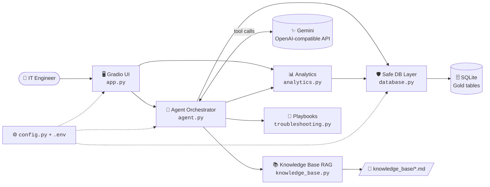
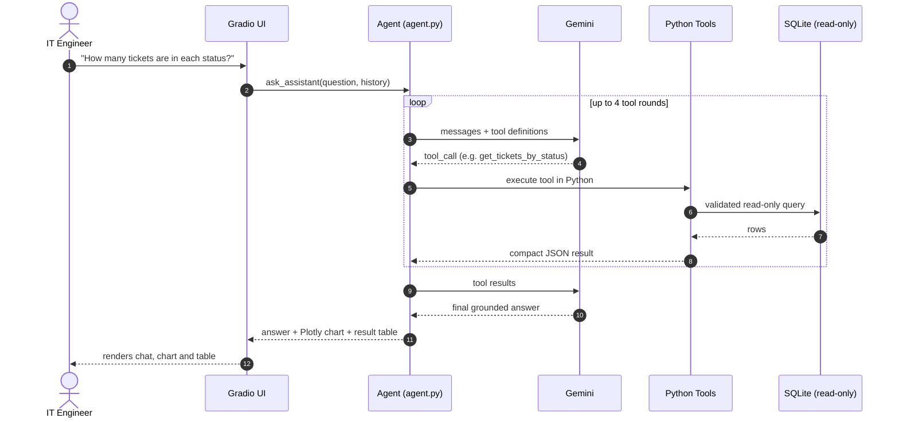
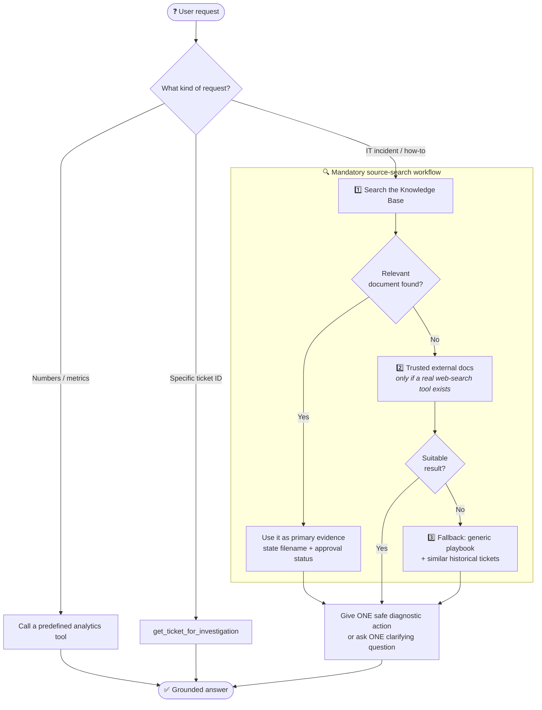
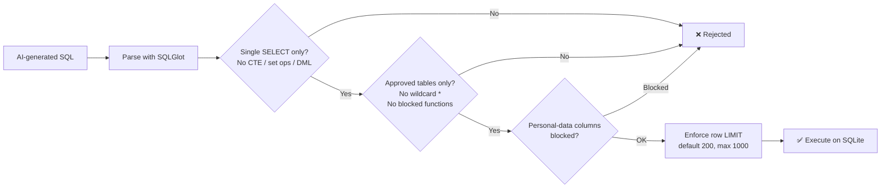

<div align="center">

# 🛠️ AI IT Operations Assistant

**An AI-powered workspace for IT support teams — explore ticket analytics, investigate individual tickets, and get grounded, safe troubleshooting guidance.**


</div>

---

## 📖 Overview

**AI IT Operations Assistant** turns a support-ticket database into an interactive operations center. IT engineers can ask questions in plain language, browse active tickets, get an AI-generated investigation for any ticket, and draft customer replies — all while the AI stays **read-only**, **grounded in real tool results**, and **privacy-aware**.

The assistant never invents numbers. Every figure comes from a predefined analytics function or a validated read-only SQL query, and troubleshooting advice is retrieved from a local knowledge base *before* falling back to generic playbooks.

## ✨ Key Features

| | Feature | What it does |
|---|---|---|
| 💬 | **Chat assistant** | Ask about ticket status, trends, SLA, resolution times, or request troubleshooting help. Returns an answer plus a relevant chart and result table. |
| 📊 | **Operations dashboard** | KPI cards (total tickets, SLA breaches, customer satisfaction) and charts by status, priority, issue category, creation trend, and resolving staff. |
| 🎫 | **Ticket workspace** | Searchable / filterable active-ticket table. Selecting a row instantly shows the record and classification, then streams in an AI investigation (Summary + Detailed Analysis). |
| ✍️ | **AI reply copilot** | Generates an editable, professional customer reply draft with one-click copy. Nothing is ever sent automatically. |
| 📚 | **Knowledge-base RAG** | Multilingual semantic search over local IT runbooks (`.md`, `.txt`, `.pdf`, `.docx`) with approval-status labels. |
| 🧪 | **Troubleshooting playbooks** | Safe, general triage steps for common IT domains used as a last-resort fallback. |
| 🔎 | **Similar-ticket search** | Keyword search over historical ticket descriptions and resolution notes for extra context. |
| 🗂️ | **Schema inspector** | Live view of the database tables and columns without modifying anything. |

## 🏗️ Architecture



## 🔄 How a Question Is Answered

The model never touches the database directly. It *requests* a tool; Python runs it and returns the result for the model to explain.



## 🧭 Intent Routing & Troubleshooting Workflow

The agent routes each request by intent. For technical issues it follows a strict **source-search order** so advice is always evidence-based.



## 🛡️ Safety & Privacy by Design



- **Read-only by construction** — only one validated `SELECT` is ever executed; the assistant cannot create, update, assign, close, or delete anything.
- **Approved schema only** — queries are limited to eight Gold tables: `facttickets`, `dimcustomer`, `dimdate`, `dimissue`, `dimstaff`, `dimticketcontext`, `dimticketflags`, `dimticketstate`.
- **PII protection** — columns such as customer email, name, age, and gender are blocked; no wildcard projections; secrets and emails are redacted from retrieved knowledge-base text.
- **Prompt-injection resistant** — retrieved documents, ticket text, and notes are treated as *untrusted evidence, never as instructions*.
- **No fabricated sources** — the model may only cite tools that actually returned results.
- **Honest metrics** — resolver attribution is never presented as assigned workload; resolution time, wall-clock time, and paused time stay distinct.
- **Secrets stay local** — API keys live in `.env` and are redacted from logs and error messages.

## 📁 Project Structure

```text
ai-it-operations-assistant/
├── app.py                  # Gradio UI: Chat, Dashboard, Ticket Workspace, Schema tabs
├── agent.py                # Gemini tool-calling orchestration + system prompt + tool schemas
├── analytics.py            # KPIs, SLA/escalation/resolution metrics, charts, ticket investigation
├── database.py             # SQLAlchemy engine, schema inspection, SQL validator (SQLGlot)
├── knowledge_base.py       # Local multilingual RAG: chunking, embeddings, semantic search
├── troubleshooting.py      # Safe general IT playbooks per issue domain
├── config.py               # Settings loaded from environment / .env
├── knowledge_base/         # Starter IT runbooks (Markdown with front-matter)
│   ├── vpn_troubleshooting.md
│   ├── network_connectivity.md
│   ├── account_access.md
│   ├── email_access.md
│   └── security_incident.md
├── data/                   # Place your local SQLite database here (git-ignored)
├── requirements.txt
├── .env.example
└── .gitignore
```

## 🧩 What Each Module Does

| Module | Responsibility |
|---|---|
| **`app.py`** | Builds the Gradio interface with three tabs — **Chat**, **Dashboard** (KPIs, filters, ticket workspace, analytics accordion) and **Database Schema**. Streams ticket details first, then the AI analysis, so the UI never freezes. Includes the reply-draft generator and clipboard copy. |
| **`agent.py`** | Defines the system prompt, the 12 tool schemas, and the tool-calling loop (max 4 rounds, retry on transient errors). Executes tools in Python, compacts results, picks the right chart, and converts API errors into friendly messages. |
| **`analytics.py`** | Predefined, verified queries: ticket summary, by status / priority / issue, trends (day → year), SLA flags, escalations, resolution & satisfaction metrics, resolver workload, active-ticket list, similar-ticket search, and single-ticket investigation. Also builds Plotly charts. |
| **`database.py`** | Connection handling with timeouts, live schema reflection, relationship verification, and the **read-only SQL validator** (SQLGlot AST checks, table/column allow-listing, forced `LIMIT`). |
| **`knowledge_base.py`** | Loads `.md/.txt/.pdf/.docx` files, parses front-matter (`approval_status`, `source_type`), splits into overlapping chunks, embeds with FastEmbed, and returns top-k excerpts by cosine similarity with a minimum score threshold. |
| **`troubleshooting.py`** | Fallback playbooks for network, account access, email, software installation, security incident, device performance, application error, and printer/peripheral issues. |
| **`config.py`** | Typed, bounded settings (`SQL_MAX_ROWS`, `DB_CONNECT_TIMEOUT`, host/port, model, DB path) loaded from `.env`. |

## 🧰 Tech Stack

| Layer | Technology |
|---|---|
| **Language** | Python |
| **UI** | Gradio |
| **LLM** | Google Gemini via the OpenAI-compatible endpoint (`openai` SDK) |
| **Data** | SQLite · SQLAlchemy · Pandas |
| **Visualization** | Plotly |
| **SQL safety** | SQLGlot (AST parsing & validation) |
| **RAG / embeddings** | FastEmbed — `paraphrase-multilingual-MiniLM-L12-v2` (runs locally, supports Arabic & English) |
| **Document parsing** | pypdf · python-docx |
| **Config** | python-dotenv |

## 🚀 Getting Started

### 1. Prerequisites

- Python 3.10+
- A [Gemini API key](https://aistudio.google.com/apikey)
- A locally prepared SQLite database containing the Gold tables listed above

> 🔒 The database and customer-level CSV exports are **intentionally excluded** from this repository. Use an authorized local database only.

### 2. Install

```powershell
py -m venv .venv
.\.venv\Scripts\python.exe -m pip install -r requirements.txt
```

<details>
<summary>macOS / Linux</summary>

```bash
python3 -m venv .venv
source .venv/bin/activate
pip install -r requirements.txt
```
</details>

### 3. Configure

```powershell
Copy-Item .env.example .env
notepad .env
```

| Variable | Description | Default |
|---|---|---|
| `GEMINI_API_KEY` | Your Gemini API key | — |
| `GEMINI_MODEL` | Model used for tool calling | `gemini-3.1-flash-lite` |
| `SQLITE_DATABASE_PATH` | Path to your local database | `./data/gold_support.db` |
| `APP_HOST` / `APP_PORT` | Where the Gradio app listens | `127.0.0.1` / `7860` |
| `SQL_MAX_ROWS` | Hard cap on rows returned by SQL (1–1000) | `200` |
| `DB_CONNECT_TIMEOUT` | Database connect timeout in seconds (1–30) | `5` |
| `RAG_EMBEDDING_MODEL` | *(optional)* Override the embedding model | multilingual MiniLM |
| `RAG_MIN_SCORE` | *(optional)* Minimum similarity for KB results | `0.25` |

### 4. Run

```powershell
.\.venv\Scripts\python.exe .\app.py
```

Open the local URL printed in the terminal (default: <http://127.0.0.1:7860>).

> ℹ️ On the first knowledge-base search, FastEmbed downloads the embedding model and caches it locally.

## 📚 Extending the Knowledge Base

Drop your own runbooks into `knowledge_base/` as `.md`, `.txt`, `.pdf`, or `.docx`. For Markdown, add front-matter so the assistant can tell official procedures from generic guidance:

```markdown
---
title: VPN connection troubleshooting basics
source_type: general_it_guidance
approval_status: not_organization_approved   # or: organization_approved
version: 1
---
# Your runbook content...
```

Documents marked `not_organization_approved` are presented as generic guidance, never as official company procedure.

## 💡 Example Questions

- *How many tickets are in each status?*
- *Show ticket creation trends by month.*
- *What are the observed SLA breach flag values and counts?*
- *Compare resolution time and first-response time, keeping the measures separate.*
- *Help me troubleshoot a VPN connection problem.*
- *Find previous tickets similar to an email sign-in failure.*
- *Investigate ticket ID 1001.*

## 🔐 Security Notes

- Keep API keys in `.env` — never in source code or `.env.example`.
- Never commit database files, customer data, or CSV exports (already covered by `.gitignore`).
- AI-generated drafts are suggestions only; review them before sending anything outside the app.

## 🗺️ Possible Next Steps

- Add a web-search tool so Step 2 of the troubleshooting workflow can cite official vendor documentation.
- Persist chat history and add per-user authentication.
- Containerize the app with Docker for one-command deployment.

---
